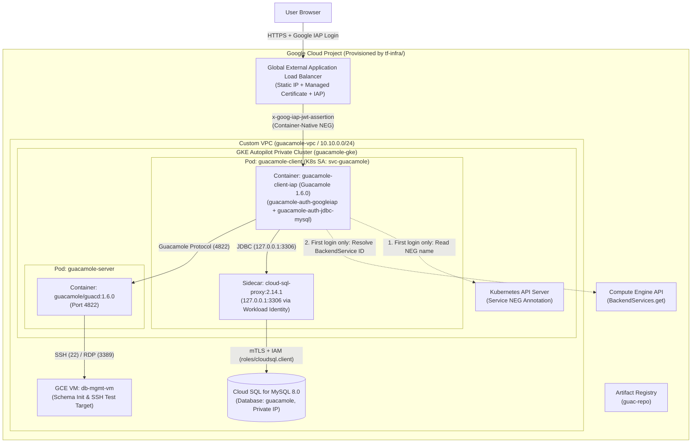

# Apache Guacamole on Google Cloud (GKE Autopilot + Identity-Aware Proxy)

This repository provides a reference architecture and end-to-end deployment automation for running **Apache Guacamole 1.6.0**—a clientless, browser-based remote desktop (RDP/VNC) and SSH gateway—on **Google Kubernetes Engine (GKE) Autopilot**, protected by **Google Cloud Identity-Aware Proxy (IAP)** and backed by **Cloud SQL for MySQL 8.0**.

---

## Architecture Overview

Rather than exposing SSH (`22`) or RDP (`3389`) ports on virtual machines to the public internet, users connect over HTTPS to a Google Cloud Global External Application Load Balancer secured by **Identity-Aware Proxy (IAP)**.



### How Authentication & Database Connectivity Work
1. **Identity-Aware Proxy (IAP) Verification (`guacamole-auth-googleiap`)**:
   - When an authorized user accesses Guacamole through the external Load Balancer, IAP authenticates their Google identity and attaches a signed `ES256` JWT in the `x-goog-iap-jwt-assertion` HTTP header.
   - On the first authentication request, the custom [`guacamole-auth-googleiap`](client/README.md) extension reads the `cloud.google.com/neg-status` annotation on `guacamole-client-service` via the in-cluster Kubernetes API, resolves the numeric Load Balancer `BackendService` ID via the Google Cloud Compute Engine API (`compute.backendServices.get`), and caches that ID in memory in a thread-safe singleton.
   - Using Google's public JWK set (`https://www.gstatic.com/iap/verify/public_key-jwk`), the extension verifies the JWT's `ES256` cryptographic signature, audience (`/projects/<PROJECT_NUMBER>/global/backendServices/<BACKEND_SERVICE_ID>`), issuer (`https://cloud.google.com/iap`), and timestamps (with 30-second clock-skew tolerance), and normalizes the verified email address to lowercase.
2. **Connection Authorization (`guacamole-auth-jdbc-mysql` + Cloud SQL Auth Proxy)**:
   - Guacamole's MySQL extension trusts the email identity verified by the IAP extension and queries the `guacamole` database on **Cloud SQL for MySQL 8.0** to load that user's authorized SSH/RDP connections and system permissions.
   - Database traffic flows from `guacamole-client` (`127.0.0.1:3306`) through a **Cloud SQL Auth Proxy v2** (`gcr.io/cloud-sql-connectors/cloud-sql-proxy:2.14.1`) sidecar container that authenticates via **GKE Workload Identity** (`roles/cloudsql.client`) over Private IP.

---

## Repository Structure

| Path | Description |
| :--- | :--- |
| [`tf-infra/`](tf-infra/README.md) | Single-stage Terraform configuration provisioning VPC networking, GKE Autopilot, Cloud SQL for MySQL 8.0, Artifact Registry, IAM / Workload Identity bindings, and rendered configuration files. |
| [`client/`](client/README.md) | Custom `guacamole-client-iap` Docker image (`guacamole/guacamole:1.6.0`), the Java 21 `guacamole-auth-googleiap` Maven extension, and Kubernetes manifests for the client Pod, Service, Ingress, ManagedCertificate, and BackendConfig. |
| [`server/`](server/README.md) | Kubernetes Deployment and Service manifests for `guacamole-server` (`guacamole/guacd:1.6.0`). |
| [`bin/read-tf-output.sh`](bin/read-tf-output.sh) | Sourced helper script that exports Terraform outputs (`PROJECT_ID`, `GKE_CLUSTER`, `ARTIFACT_REGISTRY_REPO`, `GUACAMOLE_URL`, etc.) as shell environment variables. |
| [`create-schema.sql`](create-schema.sql) | Apache Guacamole 1.6.0 MySQL schema (`utf8mb4`, including the `AUDIT` system permission). |
| [`kustomization.yaml`](kustomization.yaml) | Root Kustomize manifest assembling the `guacamole` Namespace, `svc-guacamole` ServiceAccount, ConfigMap, Secret, and client/server workloads. |
| [`skaffold.yaml`](skaffold.yaml) | Skaffold `v4beta5` pipeline for building `guacamole-client-iap` (`linux/amd64`) locally or via Google Cloud Build (`-p cloudbuild`) and deploying via Kustomize. |
| [`docs/design/repository-refresh.md`](docs/design/repository-refresh.md) | Architectural design document detailing the repository refresh and modernization. |

---

## Prerequisites

1. A **Google Cloud project** with billing enabled.
2. Configured OAuth Consent Screen for Identity-Aware Proxy in the Google Cloud Console (**APIs & Services -> OAuth consent screen**).
3. Local CLI tools installed:
   - `gcloud` (Google Cloud SDK, authenticated via `gcloud auth login` and `gcloud auth application-default login`)
   - `terraform` (`>= 1.5.0`)
   - `kubectl` and `gke-gcloud-auth-plugin`
   - `skaffold` (`>= 2.0`)

---

## Quickstart Deployment Guide

### Step 1: Provision Google Cloud Infrastructure (Single-Stage Terraform)
Run Terraform inside [`tf-infra/`](tf-infra/README.md) to enable required APIs, create the VPC, GKE Autopilot cluster, Cloud SQL MySQL 8.0 instance and `guacamole` database, Artifact Registry repository, and Workload Identity IAM bindings, and render the local configuration files:

```bash
terraform -chdir=tf-infra init
terraform -chdir=tf-infra apply -var="project_id=YOUR_PROJECT_ID"
```

### Step 2: Export Environment Variables from Terraform Outputs
From the repository root, source [`bin/read-tf-output.sh`](bin/read-tf-output.sh):

```bash
source bin/read-tf-output.sh
```

Note the **Database Root Password** printed by the script; you will enter it in the next step when initializing the MySQL schema.

### Step 3: Initialize the Cloud SQL MySQL Schema & Admin User
Copy [`create-schema.sql`](create-schema.sql) and the Terraform-rendered `insert-admin-user.sql` script to `db-mgmt-vm` over IAP TCP tunneling and load them into the `guacamole` database:

```bash
gcloud compute scp --tunnel-through-iap --project="${PROJECT_ID}" --zone="${ZONE}" \
  create-schema.sql insert-admin-user.sql "${DB_MGMT_VM}:~/"

gcloud compute ssh --tunnel-through-iap --project="${PROJECT_ID}" --zone="${ZONE}" "${DB_MGMT_VM}" --command="
  sudo apt-get update && sudo apt-get install -y default-mysql-client &&
  mysql -h ${CLOUD_SQL_IP} -u root -p guacamole < ~/create-schema.sql &&
  mysql -h ${CLOUD_SQL_IP} -u root -p guacamole < ~/insert-admin-user.sql &&
  mysql -h ${CLOUD_SQL_IP} -u root -p -e \"GRANT SELECT,INSERT,UPDATE,DELETE ON guacamole.* TO '$(terraform -chdir=tf-infra output -raw db_username)'@'%'; FLUSH PRIVILEGES;\"
"
```

### Step 4: Connect to the GKE Autopilot Cluster & Deploy with Skaffold
Fetch cluster credentials and deploy Guacamole using Skaffold (using `-p cloudbuild` to build the image in Google Cloud Build, or omit `-p cloudbuild` to build with a local Docker daemon):

```bash
gcloud container clusters get-credentials "${GKE_CLUSTER}" \
  --region="${REGION}" \
  --project="${PROJECT_ID}"

skaffold run -p cloudbuild --default-repo="${ARTIFACT_REGISTRY_REPO}"
```

### Step 5: Access the Guacamole Web UI
Wait 10–15 minutes for the GKE Ingress controller to provision the Global External Application Load Balancer and for the Google-managed SSL certificate (`guacamole-client-cert`) to reach `Active` status:

```bash
kubectl get managedcertificate guacamole-client-cert -n guacamole
```

Once the certificate status is `Active`, open `${GUACAMOLE_URL}` in your browser and sign in with your Google identity.

---

## Teardown

To delete the Kubernetes workloads and tear down all Google Cloud infrastructure cleanly:

```bash
skaffold delete
terraform -chdir=tf-infra destroy -var="project_id=${PROJECT_ID}"
```
