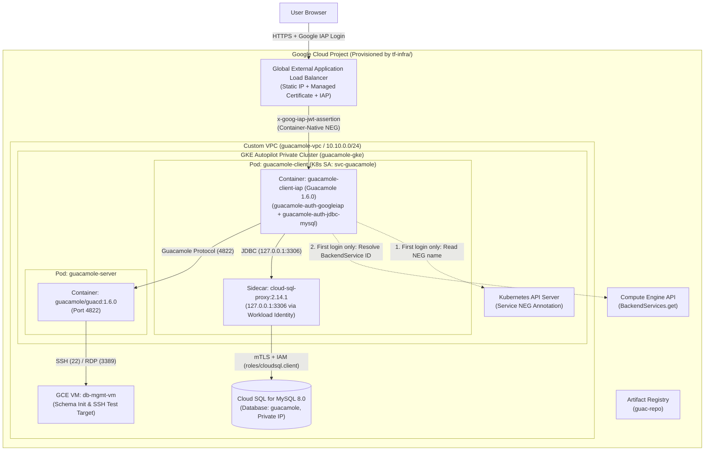

# Design Document: Guacamole on GCP Repository Refresh & Modernization

**Status:** Approved  
**Author:** Antigravity & Engineering Team  
**Last Updated:** 2026-11-03  

---

## Section 0: Problem Statement in Plain English

### What This System Does Today
This repository (`guacamole-on-gcp`) provides a reference architecture and deployment automation for running **Apache Guacamole**—a clientless, browser-based remote desktop and SSH gateway—on **Google Kubernetes Engine (GKE) Autopilot**. Rather than exposing SSH (port 22) or RDP (port 3389) on virtual machines directly to the public internet, administrators and users connect through a browser to a Google Cloud Global External Application Load Balancer protected by **Identity-Aware Proxy (IAP)**.

When a user logs in through Google IAP, IAP attaches a cryptographically signed JSON Web Token (JWT) in the `x-goog-iap-jwt-assertion` HTTP header and forwards the request into the GKE cluster to the `guacamole-client` web application. Inside `guacamole-client`, two authentication mechanisms work in sequence:
1. **`guacamole-auth-googleiap`** (a custom Java extension in this repository): Extracts the IAP JWT header, discovers the load balancer's Backend Service ID by querying the Kubernetes API (`cloud.google.com/neg-status` annotation on `guacamole-client-service`) and the Google Cloud Compute Engine API (`BackendServices.get`), verifies the JWT's cryptographic signature and audience (`aud`) claim against Google's public keys, and extracts the authenticated user's email address.
2. **`guacamole-auth-jdbc-mysql`** (Guacamole's built-in MySQL extension): Trusts the email identity verified by the IAP extension and queries a private **Cloud SQL for MySQL** instance to determine which remote connections (SSH/RDP targets) and system permissions that user is authorized to access.

Once authorized, `guacamole-client` communicates with `guacamole-server` (`guacd`, the native protocol proxy pod running in the same GKE namespace on port 4822), which establishes the actual SSH or RDP connection over the private VPC to target Compute Engine VMs (such as `db-mgmt-vm`).

### The Business & Operational Problem We Are Solving
Originally written in 2020 and only lightly patched since, the repository has accumulated significant technical debt, reliability bugs, security anti-patterns, and operational friction that prevent it from serving as a trustworthy, modern reference implementation:

1. **Per-Request API Bottleneck, Swallowed Errors & Thread-Safety Bugs in the IAP Extension**:
   Every single time a user loads or authenticates to Guacamole, `GoogleIapAuthenticationProvider` instantiates a new `AuthenticationProviderService` and `ConfigurationService` (because neither is bound as a Guice singleton). `ConfigurationService.getBackendServiceId()` creates a brand-new Kubernetes API client, mutates global static state (`Configuration.setDefaultApiClient(client)`), queries the Kubernetes API for the Service's NEG annotation, and then creates a new gRPC/HTTP `BackendServicesClient` to query the Google Cloud Compute Engine API for the numeric BackendService ID—even though that ID never changes after deployment. Furthermore, `AuthenticationProviderService` caches Google's public JWK verification keys in a non-singleton, unsynchronized `HashMap` without evicting rotated keys, uses deprecated Java APIs (`new URL(...)`), lacks clock-skew tolerance, parses the JWT twice, swallows configuration/API exceptions into `GuacamoleInvalidCredentialsException` (hiding RBAC/IAM errors at `INFO` log level) or `""` via `e.printStackTrace()`, and has zero unit tests.
2. **Brittle, Plan-Time Keystore Generation & Unencrypted ConfigMap Private Keys**:
   To connect `guacamole-client` to Cloud SQL over TLS, `tf-infra/cloudsql.tf` uses a Terraform `data "external"` block (`db-client-cert-keystore`) that shells out to `tf-infra/bin/generate-keystore.sh` during `terraform plan`. That script has a broken relative path (`${path.module}/tf-infra/bin/generate-keystore.sh` combined with `working_dir = "../"`), hardcodes `/usr/bin/keytool` and `/usr/bin/openssl` (failing on macOS and many Linux distributions), and writes a client private key into `clientstore.jks`, which `kustomization.yaml` mounts into the cluster as a plain Kubernetes `ConfigMap` (`java-trust-store`) rather than a `Secret`.
3. **Split Two-Stage Terraform Deployment (`tf-infra` and `tf-k8s`) & Missing Resources**:
   Infrastructure provisioning is split across two separate Terraform directories (`tf-infra/` and `tf-k8s/`) because `tf-k8s/` uses the `hashicorp/kubernetes` provider and `workload-identity` module to create the `guacamole` Kubernetes Namespace and `svc-guacamole` ServiceAccount, which previously caused race conditions if combined with GKE cluster creation in a single Terraform state. In addition, `tf-infra/cloudsql.tf` never creates the `guacamole` MySQL database resource itself, `tf-infra/main.tf` shells out to `tf-infra/bin/sslip-io-url.sh` via `data "external"` just to replace `.` with `-` in an IP address, and `tf-infra/iam.tf` defines a `svc-gke-node` service account that is never attached to the GKE cluster while `tf-infra/artifactrepo.tf` grants image-pull permissions to the over-privileged default Compute Engine service account.
4. **Static Tomcat `server.xml` Override & Leftover IAP OAuth Artifacts**:
   `tf-infra/templates.tf` overwrites Tomcat's entire `/usr/local/tomcat/conf/server.xml` from a 2020 Tomcat 8.5 template (`server.xml.tmpl`) solely to configure `RemoteIpValve`, even though upstream Guacamole 1.6.0 natively supports `REMOTE_IP_VALVE_ENABLED=true` and `REMOTE_IP_VALVE_INTERNAL_PROXIES` via environment variables. Meanwhile, `client/tomcat/webapps/ROOT/index.jsp` was commented out in `client/Dockerfile` since the initial commit, and half-removed files from an older manual OAuth client setup (`kustomizeconfig/backendconfig.yaml`, `tf-infra/templates/iap-secrets.properties.tmpl`, `bin/parse-iap-credentials.sh`, `client/dist/`) remain in the repository.
5. **Version Drift, Weak Kubernetes Probes/Security Contexts, and Missing Documentation**:
   Guacamole versions are mismatched across components (`guacd:1.5.5`, `guacamole:1.5.2`, `guacamole-ext:1.5.2`, `guac-manifest.json:1.5.1`) and lag behind the latest stable release (`1.6.0`). Kubernetes manifests use deprecated annotations (`beta.cloud.google.com/backend-config`), grant overly broad RBAC (`watch`/`list` on all services), lack readiness probes and container security contexts, and set `livenessProbe.failureThreshold: 1` (restarting the client pod on any single slow health check). Finally, legacy manual shell scripts in `bin/` conflict with the Terraform workflow, and the repository lacks comprehensive root and directory-level `README.md` documentation.

### Desired Outcome
We want to refresh and modernize this repository into a clean, secure, single-stage Terraform + Kustomize/Skaffold deployment that adheres to current Google Cloud, Kubernetes, Terraform, and Java 21 best practices—preserving the zero-touch dynamic BackendService ID lookup while making it thread-safe and cached, replacing manual JKS keystores with the Cloud SQL Auth Proxy sidecar, consolidating Terraform into `tf-infra/`, aligning all Guacamole components on version `1.6.0`, adding unit tests, and providing clear hierarchical documentation.

---

## Section 1: Technical Implementation Plan

### High-Level Architecture & Component Fit

The refreshed system consists of five cohesive layers that work together without manual certificate scripts or multi-stage Terraform runs:



### Component 1: Single-Stage Terraform Infrastructure (`tf-infra/`)
All Google Cloud infrastructure and IAM bindings are consolidated into a single Terraform root directory (`tf-infra/`), removing `tf-k8s/` and `tf-infra/bin/` entirely:
* **Why `tf-k8s/` is no longer needed**: Previously, `tf-k8s/` existed only to create the Kubernetes `guacamole` Namespace and `svc-guacamole` ServiceAccount via the `hashicorp/kubernetes` provider and `workload-identity` module, which failed if run in the same Terraform stage as GKE cluster creation. In GKE, a Workload Identity IAM binding on a Google Service Account (`serviceAccount:<project_id>.svc.id.goog[guacamole/svc-guacamole]`) only requires the GKE cluster's Workload Identity pool to exist—it does **not** require the Kubernetes Namespace or Kubernetes ServiceAccount to exist inside the cluster ahead of time.
* **How Workload Identity is wired**:
  1. `tf-infra/iam.tf` creates the GCP Service Account `svc-guacamole@<project_id>.iam.gserviceaccount.com`.
  2. `tf-infra/iam.tf` grants `svc-guacamole` two project IAM roles:
     - `google_project_iam_custom_role.iap-jwt-verify-role.id` (`compute.backendServices.get`) so the IAP extension can look up the load balancer's BackendService ID.
     - `roles/cloudsql.client` so the Cloud SQL Auth Proxy sidecar can connect to the Cloud SQL instance.
  3. `tf-infra/iam.tf` binds `roles/iam.workloadIdentityUser` on `svc-guacamole` to member `serviceAccount:<project_id>.svc.id.goog[guacamole/svc-guacamole]` with `depends_on = [google_container_cluster.gke]`.
  4. `tf-infra/templates.tf` renders the Kubernetes `ServiceAccount` manifest (`client/kubernetes-manifests/guacamole-client.serviceaccount.yaml`) with the `iam.gke.io/gcp-service-account: svc-guacamole@<project_id>.iam.gserviceaccount.com` annotation, and Kustomize applies both the `Namespace` (`client/kubernetes-manifests/guacamole.namespace.yaml`) and `ServiceAccount` when deploying the workloads.
* **Least-Privilege Service Accounts & Cloud Build Support**:
  - `tf-infra/iam.tf` grants `svc-gke-node` the standard GKE node roles: `roles/logging.logWriter`, `roles/monitoring.metricWriter`, `roles/monitoring.viewer`, `roles/autoscaling.metricsWriter`, and `roles/artifactregistry.reader`.
  - `tf-infra/gke.tf` configures `cluster_autoscaling { auto_provisioning_defaults { service_account = google_service_account.svc-gke-node.email, oauth_scopes = ["https://www.googleapis.com/auth/cloud-platform"] } }` on the Autopilot cluster, and `tf-infra/compute.tf` attaches `svc-gke-node` to `db-mgmt-vm`.
  - `tf-infra/artifactrepo.tf` grants `roles/artifactregistry.reader` to `svc-gke-node` and grants `roles/artifactregistry.writer` to the Compute Engine default service account and Cloud Build service account so `skaffold run -p cloudbuild` can push images to `guac-repo`.
* **Native HCL `sslip.io` Resolution, Database Resource & Lifecycle Safety**:
  - Replaces `data.external.wildcard-dns-url` and `tf-infra/bin/sslip-io-url.sh` with pure Terraform HCL: `remote_url = var.external_url == "sslip.io" ? "${replace(google_compute_global_address.guacamole-external.address, ".", "-")}.sslip.io" : var.external_url`.
  - Adds `resource "google_sql_database" "guacamole"` (`charset = "utf8mb4"`) in `tf-infra/cloudsql.tf` so the `guacamole` database is created automatically by Terraform.
  - Adds `deletion_policy = "ABANDON"` on `google_service_networking_connection.private_vpc_connection` and a `deletion_protection` boolean variable (defaulting to `false`) wired into both `google_container_cluster.gke` and `google_sql_database_instance.guacamole-mysql` for clean `terraform destroy`.
  - Uses `local_sensitive_file` (`file_permission = "0600"`) for `client/db-secrets.properties` and `insert-admin-user.sql`.

### Component 2: Cloud SQL Auth Proxy Sidecar (Replacing Manual JKS Keystores)
Instead of running `generate-keystore.sh` during `terraform plan` to build `truststore.jks` and `clientstore.jks` and mounting a client private key from a Kubernetes `ConfigMap`:
* **Sidecar Pattern**: The `guacamole-client` Pod (`client/kubernetes-manifests/guacamole-client.deployment.yaml`) includes a second container running `gcr.io/cloud-sql-connectors/cloud-sql-proxy:2.14.1`.
* **Configuration**:
  - `tf-infra/templates.tf` renders `CLOUD_SQL_CONNECTION_NAME=<project_id>:<region>:<instance_name>` into `client/client-settings.properties` (which Kustomize turns into the `guacamole-client-settings` `ConfigMap`).
  - In `client/client-settings.properties`, `MYSQL_HOSTNAME` is set to `127.0.0.1` and `MYSQL_PORT` is set to `3306`, with `MYSQL_DATABASE=guacamole`.
  - The `cloud-sql-proxy` container reads `CLOUD_SQL_CONNECTION_NAME` from the `ConfigMap`, authenticates automatically via the Pod's `svc-guacamole` Workload Identity (`roles/cloudsql.client`), and connects over Private IP (`--private-ip`) to Cloud SQL, exposing `127.0.0.1:3306` to `guacamole-client`.

### Component 3: Modernized Tomcat Proxy Configuration (`REMOTE_IP_VALVE_ENABLED` & `REMOTE_IP_VALVE_INTERNAL_PROXIES`)
Instead of overwriting `/usr/local/tomcat/conf/server.xml` inside `client/Dockerfile` using a static Tomcat 8.5 template (`tf-infra/templates/server.xml.tmpl`):
* Upstream `guacamole/guacamole:1.6.0` (`/opt/guacamole/bin/entrypoint.sh` -> `/opt/guacamole/environment/REMOTE_IP_VALVE_/configure.sh`) natively configures Tomcat's `RemoteIpValve` when `REMOTE_IP_VALVE_ENABLED=true` and `REMOTE_IP_VALVE_INTERNAL_PROXIES` are set in the container environment.
* `tf-infra/templates/client-settings.properties.tmpl` sets `REMOTE_IP_VALVE_ENABLED=true`, `REMOTE_IP_VALVE_INTERNAL_PROXIES=130\\.211\\.[0-9]{1,3}\\.[0-9]{1,3}|35\\.191\\.[0-9]{1,3}\\.[0-9]{1,3}|${external_ip}`, and `LOG_LEVEL=info` (the new standardized 1.6.0 logging variable), while `tf-infra/templates/db-secrets.properties.tmpl` uses `MYSQL_USERNAME` (replacing the deprecated `MYSQL_USER` variable in 1.6.0).
* `tf-infra/templates/server.xml.tmpl`, `client/tomcat/webapps/ROOT/index.jsp`, and the `COPY ./tomcat/conf/server.xml` line in `client/Dockerfile` are removed.

### Component 4: Refreshed Java 21 IAP Extension (`guacamole-auth-googleiap`)
The custom Guacamole authentication extension in `client/extensions/guacamole-auth-googleiap/` is upgraded and hardened:
1. **Cached BackendService ID Discovery (`ConfigurationService.java`)**:
   - `ConfigurationService` is annotated with `@Singleton` (and bound as a singleton in `GoogleIapAuthenticationProviderModule`).
   - `getProjectNumber()` uses `environment.getRequiredProperty(GoogleIapGuacamoleProperties.GOOGLE_PROJECT_NUMBER)`.
   - `getBackendServiceId()` first checks if an optional override property `google-backend-service-id` is set in `guacamole.properties`. If present and non-blank, it returns that value immediately.
   - Otherwise, it checks a `volatile String cachedBackendServiceId` field using double-checked locking (`synchronized (this)`). Only when `cachedBackendServiceId` is `null` does it query the Kubernetes API (`new CoreV1Api(client)` without mutating global `Configuration.setDefaultApiClient`) and the Compute Engine API (`BackendServicesClient`) to resolve the numeric ID.
   - Validates that the resolved ID is non-null, non-blank, and not `"0"` before caching so transient startup races are never negative-cached.
   - All errors are logged at `ERROR` level via SLF4J with full exception context and thrown as `GuacamoleServerException`—never swallowed into an empty string `""` or masked as `GuacamoleInvalidCredentialsException`.
2. **Thread-Safe JWK Caching & Single-Pass JWT Verification (`AuthenticationProviderService.java`)**:
   - Annotated with `@Singleton` (`com.google.inject.Singleton`).
   - Resolves `projectNumber` and `backendServiceId` *before* entering the JWT validation `try/catch` so infrastructure/configuration errors propagate as `GuacamoleException` (`ERROR` log) rather than being swallowed into `GuacamoleInvalidCredentialsException`.
   - Replaces the unsynchronized `HashMap<String, JWK>` with a thread-safe `ConcurrentHashMap<String, JWK>` that atomically clears/replaces stale keys on refresh when a new `kid` is loaded from `URI.create(PUBLIC_KEY_VERIFICATION_URL).toURL()`.
   - Explicitly verifies `JWSAlgorithm.ES256.equals(jwsHeader.getAlgorithm())`, checks `jwk instanceof ECKey` and `(jwk.getAlgorithm() == null || alg.equals(jwk.getAlgorithm().getName()))`, and converts via `((ECKey) jwk).toECPublicKey()`.
   - Adds a 30-second clock-skew tolerance when checking `iat` and `exp` claims, and verifies + extracts the `email` claim in a single `SignedJWT.parse(jwtToken)` pass (`verifyAndExtractEmail`).
3. **Java 21 Build, Dependency Cleanup & Unit Tests (`pom.xml` & `src/test/java/...`)**:
   - Updates `pom.xml` to version `1.6.0` targeting Java 21 (`<maven.compiler.release>21</maven.compiler.release>`), sets `guacamole-ext` (`1.6.0`) to `<scope>provided</scope>` (preventing duplicate JARs in `/etc/guacamole/lib`), removes unused `guice-multibindings` and flaky `license-maven-plugin`, pins `io.kubernetes:client-java` to `21.0.2`, upgrades Maven plugins, removes the invalid `<mainClass>`, and adds JUnit 5 + Mockito unit tests (`AuthenticationProviderServiceTest.java` and `ConfigurationServiceTest.java`) with Apache 2.0 license headers.

### Component 5: Hardened Kubernetes Manifests & Documentation Hierarchy
* Aligns `skaffold.yaml` (`CLIENT_IMAGE: guacamole/guacamole:1.6.0`, `platforms: ["linux/amd64"]`) and `server/kubernetes-manifests/guacamole-server.deployment.yaml` (`guacamole/guacd:1.6.0`) to Guacamole `1.6.0`.
* Updates `create-schema.sql` to match the Apache Guacamole `1.6.0` MySQL schema (adding the `'AUDIT'` permission to `guacamole_system_permission.permission` enum) with `DEFAULT CHARSET=utf8mb4`.
* Updates `client/kubernetes-manifests/guacamole-client.service.yaml` from `beta.cloud.google.com/backend-config` to `cloud.google.com/backend-config` and tightens `guacamole-client.role.yaml` to `verbs: ["get"]` on `resourceNames: ["guacamole-client-service"]`.
* Hardens `guacamole-client.deployment.yaml` and `guacamole-server.deployment.yaml` with `readinessProbe`, resilient `livenessProbe` (`failureThreshold: 3`), and non-root container `securityContext`.
* Removes dead legacy scripts/configs and provides clear `README.md` files at the repository root, `tf-infra/README.md`, `client/README.md`, and `server/README.md`.

---

## Section 2: Alternatives Considered & Ruled Out

During the Phase 1 co-design discussion and Phase 3 Goldfish reviews, we evaluated and ruled out the following alternatives:

### 1. Removing Dynamic K8s/GCP BackendService Discovery in Favor of a Required Static Config Property
* **Alternative**: Remove `io.kubernetes:client-java` and `com.google.cloud:google-cloud-compute` from `guacamole-auth-googleiap`, delete the Kubernetes `Role`/`RoleBinding` and GCP `iap_jwt_verifier` custom role, and require operators to pass the numeric BackendService ID statically via `guacamole.properties` or an environment variable.
* **Why Ruled Out**: In GKE, the Load Balancer `BackendService` is created asynchronously by the GKE Ingress controller *after* the Kubernetes `Ingress` and `Service` manifests are applied by Skaffold/Kustomize. Requiring a static ID would force a chicken-and-egg deployment workflow (deploy Kubernetes manifests -> wait for Ingress controller -> look up BackendService ID -> update `guacamole.properties` -> rebuild/redeploy `guacamole-client`). Keeping the dynamic discovery—while fixing it to cache the resolved ID lazily in a thread-safe `@Singleton` and allowing an optional `google-backend-service-id` override for testing—preserves the single-pass `skaffold run` deployment experience without paying the per-request API penalty.

### 2. Keeping Custom JKS Keystores (`generate-keystore.sh`) for Cloud SQL mTLS
* **Alternative**: Retain direct mTLS connections from `guacamole-client` to Cloud SQL by fixing the relative path bug in `tf-infra/cloudsql.tf`, replacing `data "external"` with a `terraform_data` local-exec provisioner, and moving `truststore.jks` and `clientstore.jks` from a Kubernetes `ConfigMap` to a `Secret`.
* **Why Ruled Out**: Even with fixed paths and a Kubernetes `Secret`, shelling out to `openssl` and `keytool` on the operator's workstation introduces brittle host tool dependencies (`jq`, `openssl`, `keytool`), leaves keystore files on disk, and requires manual certificate rotation when the Cloud SQL client certificate expires. Running the official **Cloud SQL Auth Proxy v2** (`gcr.io/cloud-sql-connectors/cloud-sql-proxy:2.14.1`) as a sidecar container authenticated via GKE Workload Identity (`roles/cloudsql.client`) eliminates all local certificate tooling, removes `google_sql_ssl_cert` and `generate-keystore.sh`, and provides automatic ephemeral certificate management and mTLS encryption.

### 3. Retaining the Two-Stage Terraform Split (`tf-infra/` + `tf-k8s/`)
* **Alternative**: Keep `tf-infra/` and `tf-k8s/` as two separate Terraform configurations that must be initialized and applied sequentially.
* **Why Ruled Out**: The two-stage split was originally introduced only because `tf-k8s/` used the `hashicorp/kubernetes` Terraform provider (via `terraform-google-modules/kubernetes-engine/google//modules/workload-identity`) to create the `guacamole` Kubernetes Namespace and `svc-guacamole` ServiceAccount, which cannot be reliably planned and applied in the same Terraform run that creates the GKE cluster. By moving the `Namespace` and annotated `ServiceAccount` manifests into Kustomize (`kustomization.yaml`)—where all other Kubernetes resources already live—and managing the GCP Service Account (`svc-guacamole`) and its `roles/iam.workloadIdentityUser` binding directly in `tf-infra/iam.tf` with `depends_on = [google_container_cluster.gke]`, Terraform no longer needs the `kubernetes` provider at all. Everything in GCP provisions cleanly in a single `terraform apply` inside `tf-infra/`.

### 4. Keeping the Custom `server.xml.tmpl` Tomcat Override
* **Alternative**: Continue rendering `client/tomcat/conf/server.xml` from `tf-infra/templates/server.xml.tmpl` and copying it over `/usr/local/tomcat/conf/server.xml` in `client/Dockerfile`.
* **Why Ruled Out**: Overwriting the entire Tomcat `server.xml` with a static template from an older Tomcat 8.5 release risks subtle incompatibilities whenever the upstream `guacamole/guacamole` base image updates its bundled Tomcat version. Because upstream Guacamole 1.6.0's `/opt/guacamole/bin/entrypoint.sh` (`REMOTE_IP_VALVE_/configure.sh`) natively supports configuring `RemoteIpValve` when `REMOTE_IP_VALVE_ENABLED=true` and `REMOTE_IP_VALVE_INTERNAL_PROXIES` are set, passing those variables through `client-settings.properties` achieves the exact same result without replacing Tomcat's configuration file.

### 5. Supporting Manual OAuth Client Secret Injection in `BackendConfig`
* **Alternative**: Keep `kustomizeconfig/backendconfig.yaml`, `tf-infra/templates/iap-secrets.properties.tmpl`, and `bin/parse-iap-credentials.sh` for manual IAP OAuth client secrets.
* **Why Ruled Out**: GKE `BackendConfig` supports enabling IAP directly with `iap.enabled: true` using the Google-managed OAuth client for IAP (introduced in PR #17). The remaining references in `kustomizeconfig/backendconfig.yaml`, `iap-secrets.properties.tmpl`, and `bin/parse-iap-credentials.sh` are dead artifacts that are not wired into `kustomization.yaml` or `tf-infra/templates.tf` and only confuse readers.

---

## Section 3: Detailed Implementation Plan & Complete File Manifest

This section enumerates **every file** to be modified, created, or deleted across the repository, along with the exact specifications and rationale for each change.

---

### 3.1 Files to Delete (Dead Code, Replaced Plumbing & Consolidated Terraform)

| File Path | Action | Rationale |
| :--- | :--- | :--- |
| `tf-k8s/main.tf` | **Delete** | Consolidated into `tf-infra/iam.tf` and Kustomize manifests (`guacamole.namespace.yaml` and `guacamole-client.serviceaccount.yaml`). |
| `tf-k8s/variables.tf` | **Delete** | Part of removed `tf-k8s/` module. |
| `tf-k8s/versions.tf` | **Delete** | Part of removed `tf-k8s/` module. |
| `tf-k8s/.gitignore` | **Delete** | Part of removed `tf-k8s/` directory (consolidated into root `.gitignore`). |
| `tf-infra/.gitignore` | **Delete** | Consolidated into root `.gitignore`. |
| `tf-infra/bin/generate-keystore.sh` | **Delete** | Replaced by the Cloud SQL Auth Proxy sidecar; manual `.jks` keystore generation via `keytool` and `openssl` is no longer needed. |
| `tf-infra/bin/sslip-io-url.sh` | **Delete** | Replaced by native Terraform HCL string interpolation (`replace(address, ".", "-")`) in `tf-infra/main.tf`, eliminating `jq`/`sed` host dependencies and the `hashicorp/external` provider. |
| `tf-infra/templates/server.xml.tmpl` | **Delete** | Replaced by Guacamole 1.6.0's native `REMOTE_IP_VALVE_ENABLED=true` and `REMOTE_IP_VALVE_INTERNAL_PROXIES` environment variables in `client-settings.properties.tmpl`. |
| `tf-infra/templates/iap-secrets.properties.tmpl` | **Delete** | Unused leftover from pre-PR-#17 manual OAuth client secret configuration. |
| `client/tomcat/webapps/ROOT/index.jsp` | **Delete** | Unused leftover file (commented out in `client/Dockerfile` since initial commit); removes the obsolete `client/tomcat/` override directory completely. |
| `kustomizeconfig/backendconfig.yaml` | **Delete** | Unused Kustomize `nameReference` transformer for the removed IAP OAuth secret. |
| `bin/create-client-settings.sh` | **Delete** | Legacy pre-Terraform manual script superseded by `tf-infra/templates.tf`. |
| `bin/create-db-secrets.sh` | **Delete** | Legacy pre-Terraform manual script superseded by `tf-infra/templates.tf`. |
| `bin/create-guacamole-properties.sh` | **Delete** | Legacy pre-Terraform manual script superseded by `tf-infra/templates.tf`. |
| `bin/create-keystore.sh` | **Delete** | Legacy pre-Terraform manual keystore script superseded by Cloud SQL Auth Proxy. |
| `bin/parse-iap-credentials.sh` | **Delete** | Legacy pre-Terraform manual OAuth script no longer used. |
| `client/dist/client-settings.properties` | **Delete** | Unused sample file in `client/dist/` superseded by `tf-infra/templates/`. |
| `client/dist/db-secrets.properties` | **Delete** | Unused sample file in `client/dist/` superseded by `tf-infra/templates/`. |
| `client/dist/guacamole.properties` | **Delete** | Unused sample file in `client/dist/` superseded by `tf-infra/templates/`. |
| `client/dist/iap-secrets.properties` | **Delete** | Unused sample file in `client/dist/`. |

---

### 3.2 Terraform Infrastructure (`tf-infra/`)

#### 1. `tf-infra/versions.tf` (Modify)
* **Exact Changes**:
  - Set `required_version = ">= 1.5.0"`.
  - Keep only the required providers with modern version constraints:
    - `google = { source = "hashicorp/google", version = ">= 5.6.0, < 7.0.0" }`
    - `random = { source = "hashicorp/random", version = ">= 3.6.0" }`
    - `local = { source = "hashicorp/local", version = ">= 2.5.0" }`
  - Remove `external`, `null`, and commented-out `google-beta`.

#### 2. `tf-infra/variables.tf` (Modify)
* **Exact Changes**:
  - Add explicit `type = string` to all string variables (`region`, `zone`, `db_name`, `db_username`, `external_url`, `db_management_vm`, `nwr_master_node`) and `type = list(string)` to `required_apis`.
  - Add `variable "deletion_protection"`:
    ```hcl
    variable "deletion_protection" {
      type        = bool
      description = "Whether to enable Terraform deletion protection on the GKE cluster and Cloud SQL instance."
      default     = false
    }
    ```
  - Update `var.required_apis` default list to include `iam.googleapis.com`, `iamcredentials.googleapis.com`, `logging.googleapis.com`, and `monitoring.googleapis.com`, and remove deprecated `stackdriver.googleapis.com` and commented-out `containerregistry.googleapis.com`:
    ```hcl
    default = [
      "artifactregistry.googleapis.com",
      "cloudbuild.googleapis.com",
      "cloudresourcemanager.googleapis.com",
      "compute.googleapis.com",
      "container.googleapis.com",
      "iam.googleapis.com",
      "iamcredentials.googleapis.com",
      "iap.googleapis.com",
      "logging.googleapis.com",
      "monitoring.googleapis.com",
      "servicenetworking.googleapis.com",
      "serviceusage.googleapis.com",
      "sqladmin.googleapis.com",
    ]
    ```

#### 3. `tf-infra/main.tf` (Modify)
* **Exact Changes**:
  - Remove empty provider blocks (`provider "null" {}`, `provider "random" {}`, `provider "external" {}`, `provider "local" {}`), `random_password.keystore_password`, `data "google_client_config" "provider"`, and `data "external" "wildcard-dns-url"`.
  - Define `locals`:
    ```hcl
    locals {
      gke_service_account_roles = [
        "roles/logging.logWriter",
        "roles/monitoring.metricWriter",
        "roles/monitoring.viewer",
        "roles/autoscaling.metricsWriter",
        "roles/artifactregistry.reader",
      ]

      remote_url = var.external_url == "sslip.io" ? "${replace(google_compute_global_address.guacamole-external.address, ".", "-")}.sslip.io" : var.external_url
    }
    ```
  - Pin `module "project-services"` to `version = "~> 15.0"` and set `disable_services_on_destroy = false`.
  - Add `depends_on = [module.project-services]` to `data "google_compute_default_service_account" "default"` and `data "google_project" "project"`.

#### 4. `tf-infra/gke.tf` (Modify)
* **Exact Changes**:
  - Configure `google_container_cluster.gke` with:
    - `deletion_protection = var.deletion_protection`
    - `cluster_autoscaling { auto_provisioning_defaults { service_account = google_service_account.svc-gke-node.email, oauth_scopes = ["https://www.googleapis.com/auth/cloud-platform"] } }`
    - `depends_on = [module.project-services, google_project_iam_member.svc-gke-node-iam]`
  - Remove obsolete commented-out `dns_config` block.

#### 5. `tf-infra/iam.tf` (Modify)
* **Exact Changes**:
  - Create `google_service_account.cluster_service_account`:
    ```hcl
    resource "google_service_account" "cluster_service_account" {
      account_id   = "svc-guacamole"
      display_name = "svc-guacamole"
      description  = "GCP Service Account bound to K8s svc-guacamole via Workload Identity"
      project      = var.project_id
      depends_on   = [module.project-services]
    }
    ```
  - Create `google_project_iam_custom_role.iap-jwt-verify-role` (with `depends_on = [module.project-services]`).
  - Bind `google_project_iam_custom_role.iap-jwt-verify-role.id` to `serviceAccount:${google_service_account.cluster_service_account.email}` via `google_project_iam_member.guacamole-iap-verifier`.
  - Bind `roles/cloudsql.client` to `serviceAccount:${google_service_account.cluster_service_account.email}` via `google_project_iam_member.guacamole-cloudsql-client`.
  - Bind `roles/iam.workloadIdentityUser` on `google_service_account.cluster_service_account.name` to `serviceAccount:${var.project_id}.svc.id.goog[guacamole/svc-guacamole]` via `google_service_account_iam_member.workload-identity-binding` with `depends_on = [google_container_cluster.gke]`.
  - Add `depends_on = [module.project-services]` to `google_service_account.svc-gke-node`.

#### 6. `tf-infra/artifactrepo.tf` (Modify)
* **Exact Changes**:
  - Bind `roles/artifactregistry.reader` on `guac-repo` to `serviceAccount:${google_service_account.svc-gke-node.email}`.
  - Bind `roles/artifactregistry.writer` on `guac-repo` to `serviceAccount:${data.google_compute_default_service_account.default.email}` so `skaffold run -p cloudbuild` (which uses the Compute Engine default service account in modern GCP projects) can push container images to `guac-repo`.

#### 7. `tf-infra/cloudsql.tf` (Modify)
* **Exact Changes**:
  - Add `deletion_policy = "ABANDON"` to `google_service_networking_connection.private_vpc_connection` (and `depends_on = [module.project-services]`).
  - Add `deletion_protection = var.deletion_protection` to `google_sql_database_instance.guacamole-mysql`.
  - Add `resource "google_sql_database" "guacamole"`:
    ```hcl
    resource "google_sql_database" "guacamole" {
      name      = "guacamole"
      instance  = google_sql_database_instance.guacamole-mysql.name
      charset   = "utf8mb4"
      collation = "utf8mb4_general_ci"
    }
    ```
  - Remove `google_sql_ssl_cert.db-client-cert` and `data.external.db-client-cert-keystore`.

#### 8. `tf-infra/compute.tf` (Modify)
* **Exact Changes**:
  - Set `auto_create_subnetworks = false` (boolean instead of string) and `depends_on = [module.project-services]` on `google_compute_network.vpc` and `google_compute_global_address.guacamole-external`.
  - On `google_compute_instance.db-management`, attach `service_account { email = google_service_account.svc-gke-node.email, scopes = ["cloud-platform"] }` and `allow_stopping_for_update = true`.
  - On `google_compute_firewall.permit-guac-to-vm-traffic`, set `source_ranges = [google_container_cluster.gke.cluster_ipv4_cidr, google_compute_subnetwork.subnet.ip_cidr_range]` so SSH/RDP traffic from `guacd` pods is permitted regardless of GKE Autopilot intra-VPC SNAT behavior.

#### 9. `tf-infra/templates.tf` (Modify)
* **Exact Changes**:
  - Change `insert-admin-user` to `resource "local_sensitive_file" "insert-admin-user"` (`file_permission = "0600"`), passing `admin_email = lower(data.google_client_openid_userinfo.me.email)`.
  - Change `db-secrets-properties` to `resource "local_sensitive_file" "db-secrets-properties"` (`file_permission = "0600"`).
  - Update `resource "local_file" "client-settings-properties"` to pass:
    ```hcl
    content = templatefile("${path.module}/templates/client-settings.properties.tmpl", {
      cloud_sql_connection_name = google_sql_database_instance.guacamole-mysql.connection_name
      external_ip               = replace(google_compute_global_address.guacamole-external.address, ".", "\\\\.")
    })
    ```
    *(Note: Double-escaping `\\\\.` ensures the rendered `.properties` file contains `\\.` so Kustomize's dotenv parser preserves `\.` in the generated Kubernetes `ConfigMap`.)*
  - Remove `resource "local_file" "tomcat-server-xml"`.
  - Add `resource "local_file" "guacamole-client-serviceaccount"` rendering `templates/guacamole-client.serviceaccount.yaml.tmpl` to `${path.module}/../client/kubernetes-manifests/guacamole-client.serviceaccount.yaml` with `gcp_service_account_email = google_service_account.cluster_service_account.email`.

#### 10. `tf-infra/templates/client-settings.properties.tmpl` & `tf-infra/templates/db-secrets.properties.tmpl` (Modify)
* **Exact Changes**:
  - `tf-infra/templates/client-settings.properties.tmpl` (aligned to Guacamole 1.6.0 environment variable names):
    ```properties
    GUACAMOLE_HOME=/etc/guacamole
    GUACD_HOSTNAME=guacamole-server-service
    GUACD_PORT=4822
    MYSQL_HOSTNAME=127.0.0.1
    MYSQL_PORT=3306
    MYSQL_DATABASE=guacamole
    CLOUD_SQL_CONNECTION_NAME=${cloud_sql_connection_name}
    REMOTE_IP_VALVE_ENABLED=true
    REMOTE_IP_VALVE_INTERNAL_PROXIES=130\\.211\\.[0-9]{1,3}\\.[0-9]{1,3}|35\\.191\\.[0-9]{1,3}\\.[0-9]{1,3}|${external_ip}
    LOG_LEVEL=info
    ```
  - `tf-infra/templates/db-secrets.properties.tmpl` (updated from deprecated `MYSQL_USER` to `MYSQL_USERNAME` in Guacamole 1.6.0):
    ```properties
    MYSQL_USERNAME=${mysql_user}
    MYSQL_PASSWORD=${mysql_password}
    ```

#### 11. `tf-infra/templates/insert-admin-user.sql.tmpl` (Modify)
* **Exact Changes**:
  - Make the script idempotent using `INSERT IGNORE INTO guacamole_entity`, `INSERT IGNORE INTO guacamole_user`, and `INSERT IGNORE INTO guacamole_system_permission` (granting `ADMINISTER` and the new 1.6.0 `AUDIT` permission) so re-running it does not fail with duplicate key errors.

#### 12. `tf-infra/templates/guacamole-client.serviceaccount.yaml.tmpl` (Create)
* **Exact Changes**:
  ```yaml
  # Copyright 2020 Google LLC
  # Licensed under the Apache License, Version 2.0
  apiVersion: v1
  kind: ServiceAccount
  metadata:
    name: svc-guacamole
    namespace: guacamole
    annotations:
      iam.gke.io/gcp-service-account: ${gcp_service_account_email}
  ```

#### 13. `tf-infra/outputs.tf` (Modify)
* **Exact Changes**:
  - Add `output "cloud_sql_instance_name"` (`google_sql_database_instance.guacamole-mysql.name`), `output "cloud_sql_connection_name"` (`google_sql_database_instance.guacamole-mysql.connection_name`), and `output "artifact_registry_repo"` (`"${var.region}-docker.pkg.dev/${var.project_id}/${google_artifact_registry_repository.guac-repo.repository_id}"`).

---

### 3.3 Java IAP Authentication Extension (`client/extensions/guacamole-auth-googleiap/`)

#### 14. `client/extensions/guacamole-auth-googleiap/pom.xml` (Modify)
* **Exact Changes**:
  - Update `<version>` from `1.5.2` to `1.6.0`.
  - Set `<maven.compiler.release>21</maven.compiler.release>` in `<properties>`.
  - Upgrade `maven-compiler-plugin` to `3.13.0` (using `<release>21</release>`), `maven-dependency-plugin` to `3.8.1`, `maven-jar-plugin` to `3.4.2` (removing `<mainClass>com.google.cloud.iap.guacamole.App</mainClass>`), `apache-rat-plugin` to `0.16.1`, and add `maven-surefire-plugin` `3.5.2`.
  - Remove `org.codehaus.mojo:license-maven-plugin` (eliminating live third-party license downloads during builds).
  - Dependencies:
    - `org.apache.guacamole:guacamole-ext:1.6.0` with `<scope>provided</scope>` (so `copy-dependencies` with `<includeScope>runtime</includeScope>` does not duplicate `guacamole-ext` into `/etc/guacamole/lib`).
    - `com.google.inject:guice:7.0.0` (and remove unused `com.google.inject.extensions:guice-multibindings`).
    - `javax.servlet:javax.servlet-api:3.1.0` with `<scope>provided</scope>`.
    - `com.nimbusds:nimbus-jose-jwt:9.47`.
    - `com.google.api-client:google-api-client:2.7.0`.
    - `com.google.cloud:google-cloud-compute:1.65.0`.
    - `io.kubernetes:client-java:21.0.2`.
    - Test dependencies (`<scope>test</scope>`): `org.junit.jupiter:junit-jupiter:5.11.3`, `org.mockito:mockito-core:5.14.2`, `org.mockito:mockito-junit-jupiter:5.14.2`, `ch.qos.logback:logback-classic:1.5.12`.

#### 15. `client/extensions/guacamole-auth-googleiap/src/main/resources/guac-manifest.json` (Modify)
* **Exact Changes**: Update `"guacamoleVersion"` from `"1.5.1"` to `"1.6.0"`.

#### 16. `client/extensions/guacamole-auth-googleiap/src/main/java/com/google/cloud/iap/guacamole/GoogleIapGuacamoleProperties.java` (Modify)
* **Exact Changes**:
  - Remove commented-out import `// import org.apache.guacamole.properties.IntegerGuacamoleProperty;`.
  - Add `GOOGLE_BACKEND_SERVICE_ID` (`"google-backend-service-id"`): optional property allowing explicit override of the GCP Backend Service ID without querying K8s/GCP APIs.
  - Ensure thorough Javadoc and comments throughout.

#### 17. `client/extensions/guacamole-auth-googleiap/src/main/java/com/google/cloud/iap/guacamole/GoogleIapAuthenticationProviderModule.java` (Modify)
* **Exact Changes**:
  - Bind `ConfigurationService.class` and `AuthenticationProviderService.class` in `Scopes.SINGLETON` (`bind(ConfigurationService.class).in(Scopes.SINGLETON);` and `bind(AuthenticationProviderService.class).in(Scopes.SINGLETON);`).

#### 18. `client/extensions/guacamole-auth-googleiap/src/main/java/com/google/cloud/iap/guacamole/ConfigurationService.java` (Modify)
* **Exact Changes**:
  - Annotate with `@Singleton` (`com.google.inject.Singleton`).
  - `getProjectId()` and `getProjectNumber()` call `environment.getRequiredProperty(...)`.
  - `getBackendServiceId()`:
    1. Checks `String configuredId = environment.getProperty(GoogleIapGuacamoleProperties.GOOGLE_BACKEND_SERVICE_ID)`. If non-null and non-blank, returns `configuredId.trim()`.
    2. Checks `String cached = this.cachedBackendServiceId`. If non-null, returns `cached`.
    3. Acquires `synchronized (this)`, re-checks `this.cachedBackendServiceId`, reads required properties (`GOOGLE_PROJECT_ID`, `GOOGLE_CLIENT_SERVICE_NAME`, `GOOGLE_CLIENT_SERVICE_NAMESPACE`, `GOOGLE_CLIENT_SERVICE_PORT`) via `environment.getRequiredProperty(...)`, and delegates to package-private `resolveBackendServiceId(projectId, serviceName, namespace, servicePort)`.
    4. Validates that the resolved ID is non-null, non-blank, and not `"0"`. If invalid, throws `GuacamoleServerException`. Stores valid ID in `this.cachedBackendServiceId` and returns it.
  - Extract package-private `static String parseNegNameFromAnnotation(String negStatusJson, String servicePort) throws GuacamoleException` so `ConfigurationServiceTest` can unit-test valid NEG JSON, null/blank annotations, malformed JSON, and missing port entries directly.
  - In `getBackendServiceName(serviceName, namespace, servicePort)`:
    - Create `ApiClient client = ClientBuilder.cluster().build();` and pass it directly to `CoreV1Api api = new CoreV1Api(client);` (never calling `Configuration.setDefaultApiClient(client)`).
    - Use the `io.kubernetes:client-java:21.0.2` fluent API: `V1Service service = api.readNamespacedService(serviceName, namespace).execute();`.
    - Extract the `cloud.google.com/neg-status` annotation safely (checking for null metadata/annotations) and delegate to `parseNegNameFromAnnotation(negStatus, servicePort)`.
  - In `getServiceId(projectId, backendService)`:
    - Propagate exceptions instead of catching `Exception` and returning `""`. Validate `response.hasId()` and `response.getId() != 0L`.

#### 19. `client/extensions/guacamole-auth-googleiap/src/main/java/com/google/cloud/iap/guacamole/AuthenticationProviderService.java` (Modify)
* **Exact Changes**:
  - Annotate with `@Singleton` (`com.google.inject.Singleton`).
  - Replace `HashMap<String, JWK> keyCache` with `ConcurrentHashMap<String, JWK> keyCache = new ConcurrentHashMap<>()`.
  - Add `private static final long CLOCK_SKEW_SECONDS = 30L;` and change `clock` to an instance field `private Clock clock = Clock.systemUTC();` with package-private `void setClock(Clock clock)` for deterministic testing.
  - Extract package-private `JWKSet loadJwkSet() throws Exception` calling `JWKSet.load(URI.create(PUBLIC_KEY_VERIFICATION_URL).toURL())` so tests can override or mock JWK loading without network calls.
  - In `getKey(String kid, String alg)` (`synchronized` on cache miss):
    - When `kid` is not found in `keyCache`, call `JWKSet jwkSet = loadJwkSet()`, build a fresh map of keys from `jwkSet.getKeys()`, and replace `keyCache` contents (`keyCache.clear(); keyCache.putAll(freshKeys);`) so rotated/revoked keys are evicted.
    - Verify `jwk instanceof ECKey` and `(jwk.getAlgorithm() == null || alg.equals(jwk.getAlgorithm().getName()))`, returning `((ECKey) jwk).toECPublicKey()`.
  - In `authenticateUser(Credentials credentials)`:
    - Validate `HttpServletRequest` and `x-goog-iap-jwt-assertion` header.
    - Resolve `String expectedAudience = String.format("/projects/%s/global/backendServices/%s", confService.getProjectNumber(), confService.getBackendServiceId());` **outside** the JWT parsing `try/catch` so `GuacamoleException` from `ConfigurationService` logs at `ERROR` and propagates directly without being swallowed into `GuacamoleInvalidCredentialsException`.
    - Call package-private `verifyAndExtractEmail(String jwtToken, String expectedAudience)` which parses `SignedJWT` **once**, verifies `JWSAlgorithm.ES256.equals(jwsHeader.getAlgorithm())`, `kid`, `aud`, `iss` (`https://cloud.google.com/iap`), `iat` (before `now.plusSeconds(CLOCK_SKEW_SECONDS)`), `exp` (after `now.minusSeconds(CLOCK_SKEW_SECONDS)`), `sub`, non-blank `email` (`claims.getStringClaim("email")`), and ECDSA signature (`ECDSAVerifier`), returning the verified email string.
    - Normalize `String normalizedUserId = userId.toLowerCase(Locale.ROOT);`, call `credentials.setUsername(normalizedUserId);` (so Guacamole `1.6.0` `${GUAC_USERNAME}` connection parameter tokens work), and initialize `AuthenticatedUser`.

#### 20. `client/extensions/guacamole-auth-googleiap/src/main/java/com/google/cloud/iap/guacamole/GoogleIapAuthenticationProvider.java` (Modify)
* **Exact Changes**: Fix Javadoc references from `HTTPHeaderAuthenticationProvider` to `GoogleIapAuthenticationProvider` and add clear inline comments.

#### 21. `client/extensions/guacamole-auth-googleiap/src/main/java/com/google/cloud/iap/guacamole/user/AuthenticatedUser.java` (Modify)
* **Exact Changes**: Use `username.toLowerCase(Locale.ROOT)` and update Javadoc/comments.

#### 22. `client/extensions/guacamole-auth-googleiap/src/test/java/com/google/cloud/iap/guacamole/AuthenticationProviderServiceTest.java` (Create)
* **Exact Changes**:
  - Include the Apache 2.0 license header at the top of the file to satisfy `apache-rat-plugin`.
  - JUnit 5 test suite covering:
    1. Valid `ES256` (`P-256`) signed JWT authenticates user and lowercases email (`Alice.Smith@Example.com` -> `alice.smith@example.com`).
    2. Missing `HttpServletRequest` or missing `x-goog-iap-jwt-assertion` header throws `GuacamoleInvalidCredentialsException`.
    3. Expired JWT (beyond 30s clock skew) is rejected.
    4. Minor clock skew (within 30s tolerance on `iat` and `exp`) succeeds.
    5. Wrong `aud` or wrong `iss` is rejected.
    6. Token signed with an untrusted EC key is rejected.
    7. Key rotation: when a token arrives with a new `kid`, `loadJwkSet()` is invoked, the new key is cached, and old evicted keys are no longer trusted.
    8. `ConfigurationService` failure propagates as `GuacamoleServerException` rather than being masked as `GuacamoleInvalidCredentialsException`.

#### 23. `client/extensions/guacamole-auth-googleiap/src/test/java/com/google/cloud/iap/guacamole/ConfigurationServiceTest.java` (Create)
* **Exact Changes**:
  - Include the Apache 2.0 license header at the top of the file to satisfy `apache-rat-plugin`.
  - JUnit 5 test suite covering:
    1. Explicit `google-backend-service-id` property in `Environment` is returned immediately without calling `resolveBackendServiceId`.
    2. Dynamic `resolveBackendServiceId` is called once and cached across subsequent `getBackendServiceId()` calls.
    3. Invalid resolved IDs (`""` or `"0"`) throw `GuacamoleServerException` and are not negative-cached.
    4. `parseNegNameFromAnnotation` extracts the NEG name for port `"80"` and throws `GuacamoleException` on null/blank JSON, malformed JSON, or missing port key.

---

### 3.4 Docker, Kustomize, Skaffold & Kubernetes Manifests

#### 24. `client/Dockerfile` (Modify)
* **Exact Changes**:
  - Set default `ARG CLIENT_IMAGE=guacamole/guacamole:1.6.0`.
  - Remove `RUN rm -rf /usr/local/tomcat/webapps/...` (no longer needed in `guacamole:1.6.0` because `500-generate-tomcat-catalina-base.sh` creates an isolated `CATALINA_BASE` in `/tmp`, and `RUN` would fail as non-root `USER guacamole`).
  - Remove `COPY ./tomcat/conf/server.xml /usr/local/tomcat/conf` and commented-out `# COPY ./tomcat/webapps/ROOT/index.jsp`.
  - Use `COPY --chown=guacamole:guacamole ./guacamole.properties /etc/guacamole/guacamole.properties` and `COPY --from=builder --chown=guacamole:guacamole /etc/guacamole/ .` so non-root user `guacamole` (UID 1001) always has read permissions regardless of host `umask`.
  - Update `CMD ["/opt/guacamole/bin/entrypoint.sh"]` (replacing `/opt/guacamole/bin/start.sh`, which was removed in Guacamole `1.6.0`).

#### 25. `client/bin/build-googleiap.sh` (Modify)
* **Exact Changes**:
  - Quote all path variables (`"$BUILD_DIR"`, `"$DESTINATION"`), run `mvn -B package`, and fail explicitly if the target JAR is not produced.

#### 26. `skaffold.yaml` (Modify)
* **Exact Changes**:
  - Update `CLIENT_IMAGE` to `guacamole/guacamole:1.6.0`.
  - Add `platforms: ["linux/amd64"]` under `build:` so builds on Apple Silicon (`arm64`) hosts target `linux/amd64` GKE Autopilot nodes cleanly.

#### 27. `kustomization.yaml` (Modify)
* **Exact Changes**:
  - Remove `configurations: [./kustomizeconfig/backendconfig.yaml]`.
  - Remove the `java-trust-store` entry under `configMapGenerator:`.
  - Add `client/kubernetes-manifests/guacamole.namespace.yaml` and `client/kubernetes-manifests/guacamole-client.serviceaccount.yaml` to `resources:`.

#### 28. `client/kubernetes-manifests/guacamole.namespace.yaml` (Create)
* **Exact Changes**: Declarative `Namespace` manifest (`name: guacamole`).

#### 29. `client/kubernetes-manifests/guacamole-client.deployment.yaml` (Modify)
* **Exact Changes**:
  - Remove the `config-volume` (`java-trust-store`) volume and volumeMount.
  - Configure `guacamole-client` container with:
    - `readinessProbe` (`httpGet` on `/guacamole`, `port: serving-port`, `initialDelaySeconds: 20`, `periodSeconds: 10`, `timeoutSeconds: 5`, `failureThreshold: 3`).
    - `livenessProbe` (`failureThreshold: 3` instead of `1`).
    - `securityContext` (`runAsNonRoot: true`, `runAsUser: 1001`, `allowPrivilegeEscalation: false`, `capabilities: { drop: ["ALL"] }`).
  - Add `cloud-sql-proxy` sidecar container:
    - `image: gcr.io/cloud-sql-connectors/cloud-sql-proxy:2.14.1`
    - `args: ["--private-ip", "--structured-logs", "--port=3306", "$(CLOUD_SQL_CONNECTION_NAME)"]`
    - `envFrom` referencing `guacamole-client-settings` ConfigMap.
    - `resources`: `requests/limits` (`cpu: 250m`, `memory: 256Mi`).
    - `securityContext` (`runAsNonRoot: true`, `allowPrivilegeEscalation: false`, `capabilities: { drop: ["ALL"] }`).

#### 30. `client/kubernetes-manifests/guacamole-client.service.yaml` (Modify)
* **Exact Changes**: Update annotation `beta.cloud.google.com/backend-config` to `cloud.google.com/backend-config`.

#### 31. `client/kubernetes-manifests/guacamole-client.role.yaml` (Modify)
* **Exact Changes**: Restrict RBAC rule to least privilege: `verbs: ["get"]` and `resourceNames: ["guacamole-client-service"]`.

#### 32. `server/kubernetes-manifests/guacamole-server.deployment.yaml` (Modify)
* **Exact Changes**:
  - Update `image: guacamole/guacd:1.6.0`.
  - Add `tcpSocket` `readinessProbe` and `livenessProbe` on port `4822` (`guacd`).
  - Add `securityContext` (`runAsNonRoot: true`, `runAsUser: 1000`, `allowPrivilegeEscalation: false`, `capabilities: { drop: ["ALL"] }`).

---

### 3.5 SQL Schema, Helper Scripts, `.gitignore` & Documentation (`README.md` Hierarchy)

#### 33. `create-schema.sql` (Modify)
* **Exact Changes**:
  - Align with Apache Guacamole `1.6.0` (`001-create-schema.sql`, `GUACAMOLE-538`) by adding `'AUDIT'` to the `guacamole_system_permission.permission` enum (`enum('CREATE_CONNECTION','CREATE_CONNECTION_GROUP','CREATE_SHARING_PROFILE','CREATE_USER','CREATE_USER_GROUP','AUDIT','ADMINISTER')`).
  - Update table definitions from deprecated `DEFAULT CHARSET=utf8` (`utf8mb3`) to `DEFAULT CHARSET=utf8mb4`.

#### 34. `bin/read-tf-output.sh` (Modify)
* **Exact Changes**:
  - Modernize using `terraform -chdir=tf-infra output -raw ...` (note: do not use `set -e` or `exit` since this script is meant to be sourced via `source bin/read-tf-output.sh`).
  - Export `CLOUD_SQL_IP` (`db_address`), `CLOUD_SQL_INSTANCE` (`cloud_sql_instance_name`), `CLOUD_SQL_CONNECTION_NAME` (`cloud_sql_connection_name`), `ARTIFACT_REGISTRY_REPO` (`artifact_registry_repo`), `ZONE`, `REGION`, `DB_MGMT_VM`, `PROJECT_ID`, `GKE_CLUSTER`, `GUACAMOLE_URL`, and `SUBNET`.

#### 35. `.gitignore` (Modify)
* **Exact Changes**:
  - Ignore generated config files (`client/client-settings.properties`, `client/db-secrets.properties`, `client/guacamole.properties`, `client/kubernetes-manifests/guacamole-client.managedcert.yaml`, `client/kubernetes-manifests/guacamole-client.serviceaccount.yaml`, `insert-admin-user.sql`), Terraform state and working directories (`**/.terraform/`, `*.tfstate`, `*.tfstate.*`, `*.tfvars`, `.terraform.lock.hcl`), Maven build output (`**/target/`), and IDE files (`.vscode/`, `.idea/`, `.DS_Store`).

#### 36. `README.md` (Modify)
* **Exact Changes**: Comprehensive root documentation covering architecture, authentication flow, directory layout, prerequisites, single-stage Terraform provisioning (`tf-infra/`), Cloud SQL schema initialization, and Skaffold deployment (`skaffold run --default-repo=...`).

#### 37. `tf-infra/README.md` (Create)
* **Exact Changes**: Directory-level documentation describing every `.tf` file, template, input variable, output, IAM role, and Workload Identity binding in `tf-infra/`.

#### 38. `client/README.md` (Create)
* **Exact Changes**: Directory-level documentation describing the `guacamole-client` image build, the `guacamole-auth-googleiap` Java 21 extension architecture, unit tests (`mvn test`), and Kubernetes manifests.

#### 39. `server/README.md` (Create)
* **Exact Changes**: Directory-level documentation describing the `guacamole-server` (`guacd`) deployment and service manifests.
